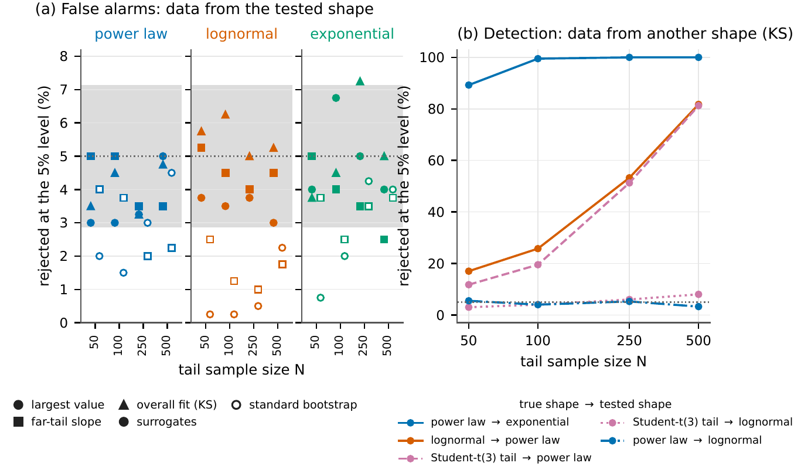
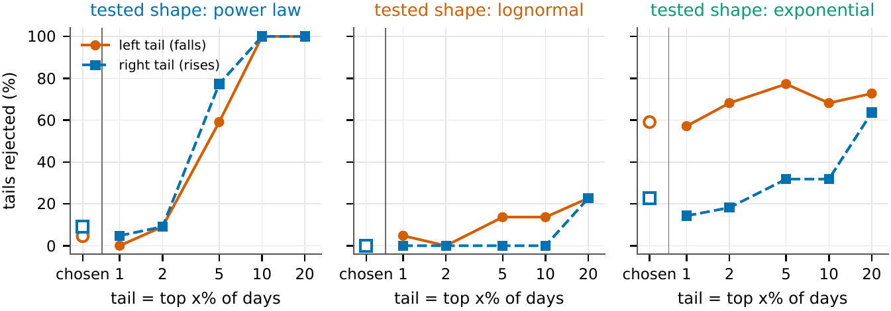

# Testing for heavy tails in financial returns

Parameter-free tests of whether the tails of daily returns follow a power law, a lognormal or an exponential, using constrained surrogates. Applied to both tails of 22 assets in six asset classes.

## Summary

Large daily losses happen far more often than a normal distribution predicts. For risk management it matters *which* heavy-tailed shape describes them, because the shape decides how likely a loss larger than any seen so far is. The usual tests first fit the shape and then test with the fitted parameters plugged in. Tails are small samples, so these tests are unreliable: they reject too rarely, and they overstate the probability of extremes beyond the data.

Constrained surrogates (Moore & Altmann, 2026; Moore, Yan & Altmann, 2022) avoid this. The idea is like shuffling. A shuffled time series is just as likely as the original under any model of independent draws, so comparing data with shuffles tests independence without assuming a model. In the same way, the fit of a tail shape depends on the data only through a simple summary (for a power law, the sum of the logarithms of the tail values). Rearranging the tail values while keeping that summary fixed gives new samples that are just as likely as the data under *every* member of the family. Comparing the data with these surrogates tests the whole family at once, without estimating a parameter.

This repository re-implements the method in Python, independently of the authors' code, checks it on simulated data, and asks four questions of real returns:

1. **Are the tails heavier than exponential?** Mostly for losses. After removing volatility clustering, the exponential is rejected for 13 of 22 loss tails but only 5 of 22 gain tails.
2. **Does a single power law describe the tail?** Only its far end. At the usual data-chosen threshold (typically the top 2–3% of days) the power law survives for 41 of 44 tails, but it is rejected for all 44 once the tail is the top 10% of days. The lognormal, tested on the same tails, mostly survives.
3. **Are losses heavier-tailed than gains?** They tend to be: the loss tail is heavier for 19 of 22 assets. This is a pattern across assets, not a firm result for any single one.
4. **Do the surrogates give better value-at-risk forecasts?** No. At 99–99.5% one-day VaR they match the usual forecast from the same shape. Their value is in checking tail models, not in forecasting.

## How it works

* **Remove volatility clustering.** Large moves cluster in time, but the tests assume independent draws. Each asset's returns are divided by their predicted volatility from a GARCH model. Three standard versions are fitted and the best by BIC is chosen before any test; a GJR-GARCH with Student-t shocks wins for 21 of 22 assets. Results are about these standardised shocks.
* **Three shapes.** Above a threshold, the tail is compared with a power law (heaviest), a lognormal and an exponential (thinnest). A power law is a limiting case of a lognormal, so no test can reject a power law *as* a lognormal.
* **Surrogates.** For the power law and exponential, a surrogate repeatedly picks two tail values and splits their total at random, which keeps the sum fixed. For the lognormal it moves three values at a time, keeping both the sum and the sum of squares fixed. Each surrogate has exactly the same fitted parameters as the data. The samplers are in [`src/tailsurr/surrogates.py`](src/tailsurr/surrogates.py) (about 200 lines).
* **Three statistics**, each asking a different question: the **largest value** (is the biggest move too big or too small for this shape?), the **far-tail slope** (does the very end of the tail fall off like the rest?) and the **overall fit** (Kolmogorov–Smirnov distance). The p-value is the share of surrogates at least as extreme as the data.
* **Where the tail starts.** The threshold is chosen by the standard rule of Clauset, Shalizi & Newman (2009), which favours the power law. Every test is therefore repeated with the tail set to the top 1, 2, 5, 10 and 20% of days.
* **Many tests.** The false discovery rate is controlled at 5% (Benjamini–Hochberg). Evidence is pooled across assets with a test that remains valid when assets move together (Cauchy combination), and tail indices are pooled with a random-effects model.

## Checking the method

On simulated tails with a known shape ([`scripts/01_validate_synthetic.py`](scripts/01_validate_synthetic.py)):

* **False alarms.** When the data come from the tested shape, the surrogate tests reject about 5% of the time at the 5% level, as they should (2.5–7.3% across all shapes, statistics and sample sizes). The standard approach of testing against a fitted distribution rejects too rarely, most of all for the lognormal.
* **Telling shapes apart.** An exponential is usually rejected for heavy-tailed data even with 50 tail values. Separating a lognormal from a power law needs several hundred.
* **Probabilities of new extremes.** For a loss beyond the sample maximum, plugging in the fitted parameter overstates its probability by about a quarter; the surrogate estimate is close to unbiased.
* **Agreement with the authors' code.** Surrogates from this implementation and the authors' reference code are statistically indistinguishable ([`scripts/06_crosscheck_reference.py`](scripts/06_crosscheck_reference.py); the reference code is not included).

**One important caveat.** In real data the threshold is chosen from the data. The tests then reject *less* often than they should when the shape is right, so a rejection is strong evidence but a non-rejection is weak. An attempt to correct for this, re-selecting the threshold inside each surrogate, over-rejects (about 15% at nominal 5%; [`scripts/10_check_selection_aware.py`](scripts/10_check_selection_aware.py)), so it is not used.

## Results

The data are free daily closes, ending October 2026, for 22 assets: equity indices, large single stocks, currencies, gold, oil, the 10-year Treasury yield, Bitcoin and Ether (Yahoo Finance and FRED).

**Thin tails are rejected, mainly for losses.** After removing volatility clustering, the exponential is rejected for 13 of 22 loss tails but only 5 of 22 gain tails. On raw returns it is rejected far more often, so part of the raw heavy tail comes from volatility clustering.

**A single power law fits only the far tail.** It survives where the tail is short, but it is rejected for every asset once the tail covers the top 10% of days. The lognormal, tested on the same tails, mostly survives.

**Losses tend to be heavier-tailed than gains**, for 19 of 22 assets. This is a pattern across assets, not a firm result for any single one.

**No better risk forecasts.** In a rolling test of one-day value-at-risk on the S&P 500 and Bitcoin, the surrogate forecasts match the usual forecasts from the same shape. The method is useful for checking tail models, not for forecasting.

---

AI assistance was used in this writeup.
