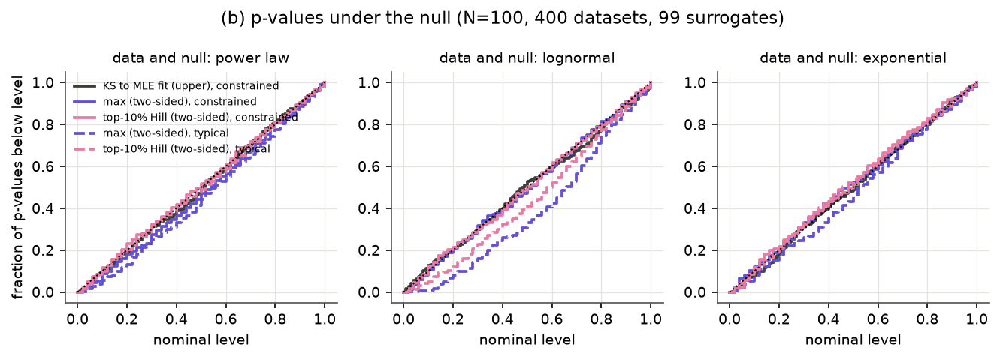
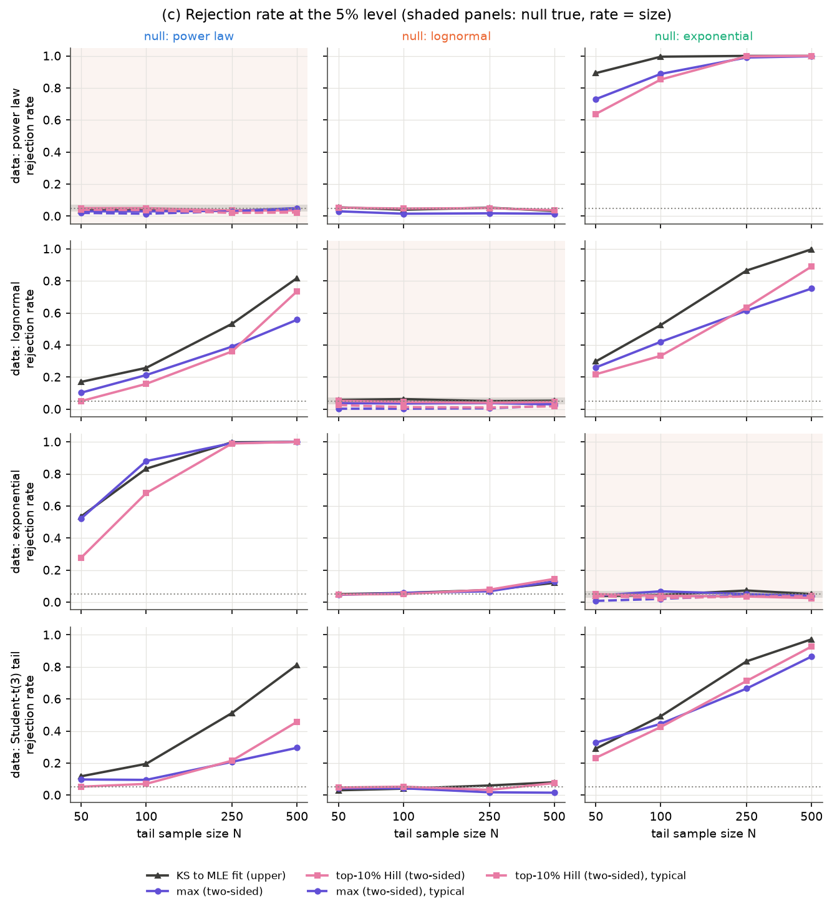
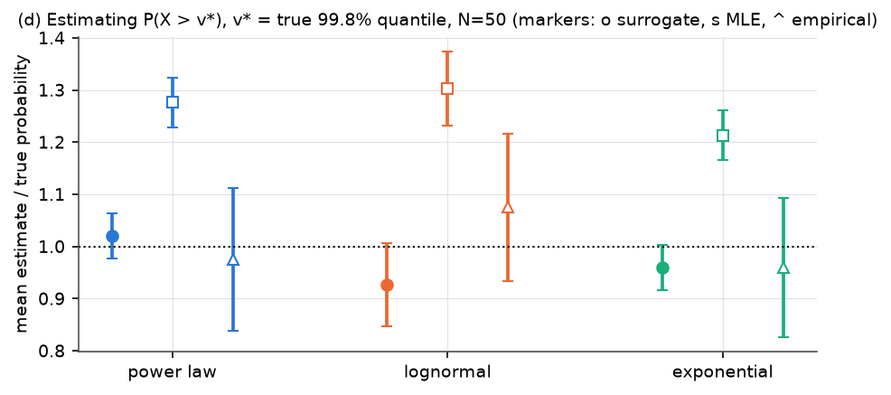
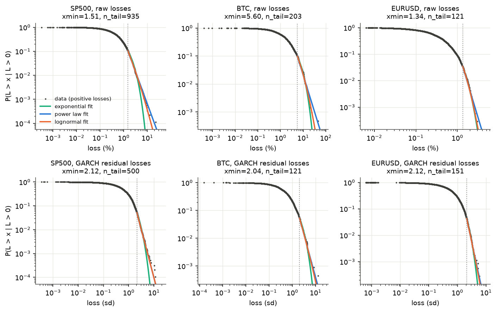
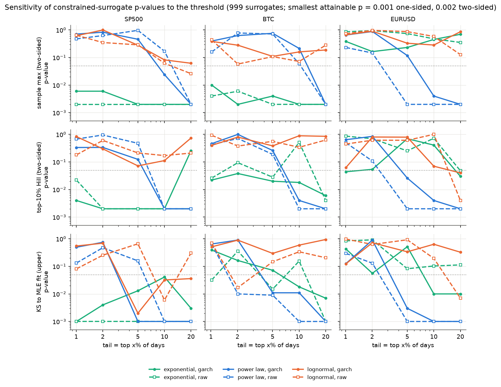
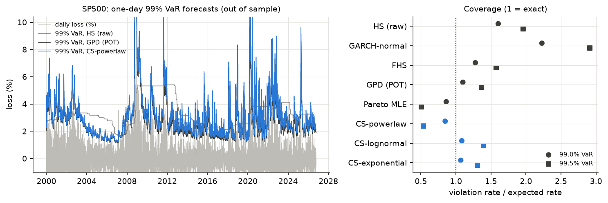
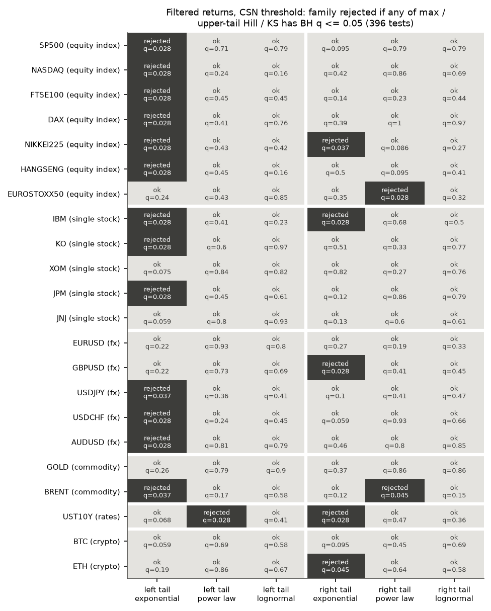
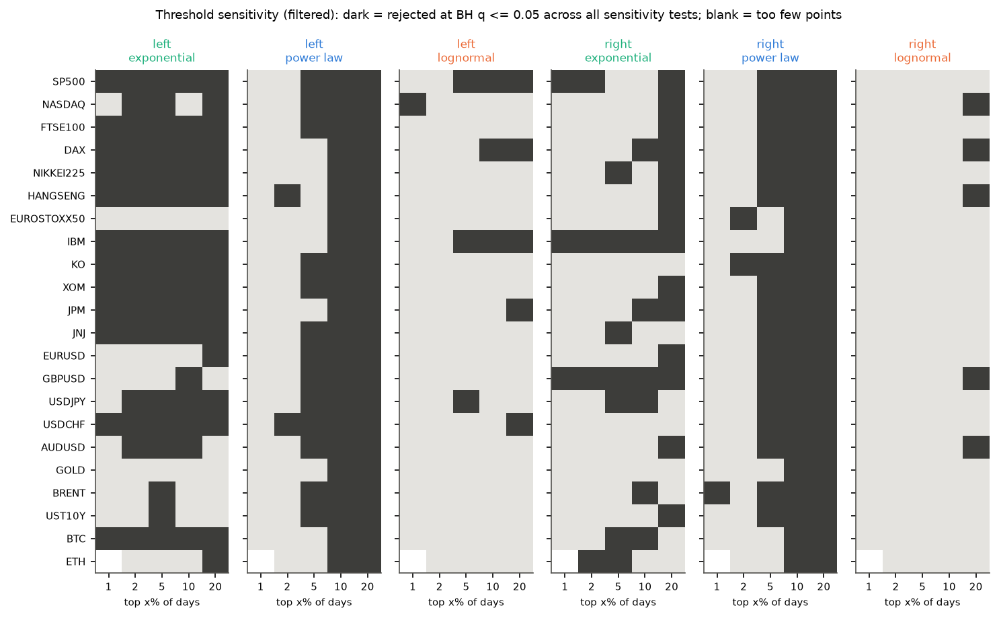
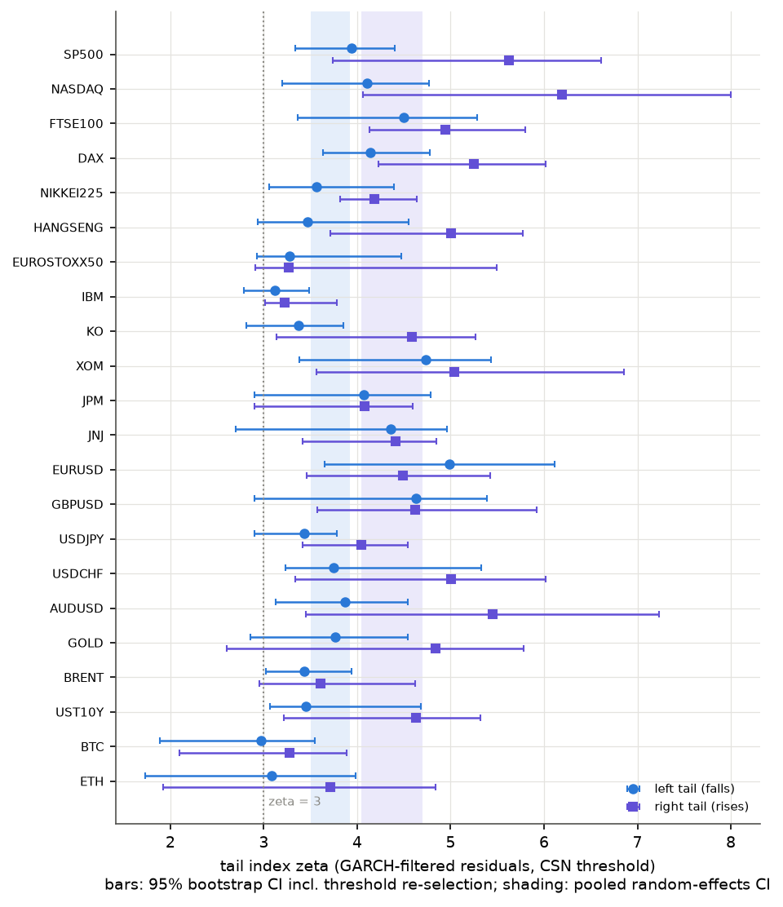

# Constrained surrogates for financial tail risk

Exact, parameter-free goodness-of-fit tests for power-law, lognormal and exponential tails of daily returns, applied to 22 assets in six asset classes.

## Abstract

Is the loss tail of an asset a power law, a lognormal, or something thinner? The usual approach fits a parameter (Hill, GPD or maximum likelihood) and then tests or extrapolates with that estimate plugged in. This biases small-sample tests and estimates of extreme-event probabilities. **Constrained surrogates** (Moore & Altmann, 2026; Moore, Yan & Altmann, 2022) avoid the problem. They resample the tail sample uniformly from all samples with the same sufficient statistic under the hypothesised family. Tests built on them are exact for any test statistic and need no parameter estimate, and their tail-probability estimates are unbiased (Rao–Blackwell).

This repository re-implements the continuous-family samplers in Python, independently of the authors' code, and validates them on synthetic data. It then applies them to GARCH-filtered daily returns in three stages: a 3-asset pilot (S&P 500, Bitcoin, EUR/USD) with an out-of-sample VaR/ES backtest, and a 22-asset, two-tailed extension with false-discovery-rate control and pooled cross-asset tests. The main findings:

* **Exponential (thin) tails are rejected** for most equity, FX and commodity left tails after volatility filtering (13 of 22 left tails, 5 of 22 right tails, BH q ≤ 0.05). Every asset class rejects them in pooled tests.
* **A power law fits only the far tail.** It survives at the data-selected threshold for 41 of 44 asset-sides, but every one of the 44 rejects it once the tail covers the top 10% of days.
* **The lognormal is never rejected**, and no single asset separates it from a power law. A pooled directional test gives modest evidence (p ≈ 0.02) that tails bend down relative to a power law.
* **Left tails are heavier than right tails** for 19 of 22 assets. The pooled tail index ζ = α − 1 is 3.71 [3.50, 3.92] for falls and 4.37 [4.05, 4.70] for rises.
* **The surrogates do not improve VaR/ES forecasts.** At 99–99.5% one-day VaR they track the parametric forecast of the same family almost exactly. Their value here is model criticism, not forecasting.

## Method

For an i.i.d. sample above a known threshold `xmin`, the likelihood depends on the data only through a sufficient statistic: `Σ log x` for the power law, `Σ x` for the exponential, and the pair `Σ log x`, `Σ (log x)²` for the truncated lognormal. The conditional distribution of the sample given that statistic does not depend on the unknown parameters. Following Moore & Altmann (2026), it is sampled by MCMC, using local moves that keep the statistic fixed exactly:

| family | transformed variable `u ≥ 0` | move (per step, per chain) |
|---|---|---|
| exponential | `x − xmin` | pick 2 entries; keep their sum; draw a new split uniformly |
| power law | `log(x/xmin)` | as for the exponential, in log space |
| lognormal | `log(x/xmin)` | pick 3 entries; keep their sum and sum of squares (a circle); draw a uniform angle; re-draw if any `u < 0` |

Each surrogate uses `N (log₂N + 10)` transitions (the authors' default). Many chains run in parallel as vectorised NumPy, one chain per surrogate, each starting at the data. The p-value is the rank of the observed statistic among `M` surrogates, `(1 + #{s_surr ≥ s_obs}) / (M + 1)`; two-sided tests double the smaller tail. Three tail statistics are used: the sample maximum, the Hill index of the top 10% of the tail sample, and the KS distance to the maximum-likelihood fit.

The samplers are in [`src/tailsurr/surrogates.py`](src/tailsurr/surrogates.py) (about 200 lines). The rest of the package covers fitting and threshold selection ([`fitting.py`](src/tailsurr/fitting.py), [`selection.py`](src/tailsurr/selection.py)), statistics and p-values ([`stats.py`](src/tailsurr/stats.py)), volatility filters ([`filters.py`](src/tailsurr/filters.py)), multiple testing ([`multitest.py`](src/tailsurr/multitest.py)) and VaR/ES backtesting ([`backtest.py`](src/tailsurr/backtest.py)).

**Real data.** Losses are `L = −100 · log return` (percent); right tails use `+100 · log return`. Raw returns are strongly clustered in time, which violates the i.i.d. null, so the tests are applied to standardised residuals of a volatility filter (McNeil & Frey, 2000). The threshold is the Clauset–Shalizi–Newman (CSN) KS-minimising `xmin`, with a minimum of 50 tail points, and sensitivity is checked at fixed tail sizes of 1, 2, 5, 10 and 20% of days.

## 1. Validation on synthetic data

[`scripts/01_validate_synthetic.py`](scripts/01_validate_synthetic.py) uses the parameters of the paper's Table III with `xmin = 1`: power law (α = 2.5), truncated lognormal (μ = −1, σ = 1) and exponential (λ = 1). It also uses a finance-like alternative, a Student-t(3) tail above its 90% quantile. Each cell has 400 datasets × 99 surrogates, for N ∈ {50, 100, 250, 500}.

* **Analytic check.** For the power law and exponential, one surrogate element given `T = Σu` has the law `T · Beta(1, N−1)`. Its survival function is the UMVU estimator. The surrogate marginals match it to Monte-Carlo precision: for an exponential sample with N = 60, `P(X > v)` at v = 1.5 / 2.5 / 4 is 0.651 / 0.266 / 0.070 from the surrogates, against 0.647 / 0.268 / 0.070 exactly. Sufficient statistics are preserved to about 1e-13.
* **Commutativity** (N = 50, 4000 datasets). Surrogates of samples are distributed like fresh samples (two-sample KS p = 0.14–1.00 for the max and the upper-tail Hill index). "Typical" fit-then-resample surrogates fail this for the max in all three families (p < 1e-4).
* **Exact size.** Across all 36 null cells (family × N × statistic) the rejection rate at nominal 5% is **2.5–7.3% (mean 4.4%)**, within the ±2.1% binomial band for 400 datasets. The typical-surrogate (parametric bootstrap) test is undersized at 0.25–4.5% (mean 2.4%), worst for the lognormal.

  

* **Power** (5% level). Exponential versus heavy tails is easy: power-law data are rejected as exponential 64–89% of the time at N = 50, and about 100% of the time at N ≥ 250. Lognormal data are rejected as a power law 17% (N = 50) to 82% (N = 500) of the time by KS. Student-t(3) tails are rejected as a power law 12% to 81% of the time. **Power-law data are never rejected as lognormal**, because the lognormal family contains the power law as a limit. That is a property of the question, not of the method.

  

* **Probability of an unseen extreme.** Take v* as the true 99.8% quantile, which exceeds the sample maximum in about 90% of samples of size 50. Over 2000 datasets, the surrogate estimate of P(X > v*) has a relative bias of +2% (power law), −7% (lognormal) and −4% (exponential), against **+21% to +30%** for the MLE plug-in. Surrogates also reduce the RMSE for the power law and exponential, but not for the lognormal, where the plug-in's lower variance wins.

  

* **Mixing.** Using 1× or 4× the default number of transitions changes no statistic significantly (all |z| < 1.9; [`scripts/05_mixing_check.py`](scripts/05_mixing_check.py)).

**Comparison with the authors' code.** [`scripts/06_crosscheck_reference.py`](scripts/06_crosscheck_reference.py) is an optional comparison with the authors' reference implementation ([JackMurdochMoore/surrogates-for-distributions](https://github.com/JackMurdochMoore/surrogates-for-distributions), checked at commit `14cb9e0`). That code is **not included in this repository**. You clone it yourself, and the script loads it from the path you pass in at run time. Power-law and lognormal surrogates from the two implementations are statistically indistinguishable (two-sample KS p = 0.24–0.94). For the exponential with `xmin ≠ 0`, the reference sampler as called here also holds fixed the number of points above `2·xmin`. It agrees with the analytic conditional law once its cut-off is given in shifted coordinates ([`results/crosscheck_reference.txt`](results/crosscheck_reference.txt)).

## 2. Pilot: S&P 500, Bitcoin, EUR/USD

| asset | source | span | daily returns |
|---|---|---|---|
| S&P 500 index | Yahoo Finance `^GSPC` | 1950-01-03 to 2026-10-12 | 19,315 |
| Bitcoin | Yahoo Finance `BTC-USD` | 2014-09-17 to 2026-10-12 | 4,408 |
| EUR/USD | FRED `DEXUSEU` | 1999-01-04 to 2026-10-02 | 6,959 |

Yahoo's `EURUSD=X` was rejected because it contains bad ticks (for example +16.0% then −14.3% on 8–9 December 2008). Script: [`scripts/03_pilot_tail_tests.py`](scripts/03_pilot_tail_tests.py).

**Clustering.** The coefficient of variation of waiting times between top-5% losses is 1.55–1.99 for raw returns (i.i.d. gives about 0.97; p = 0.001 against 999 shuffles). After a GARCH(1,1) filter it falls to 0.97–1.03, with a small amount of clustering left for the S&P 500 (p = 0.023).

**Tail tests on GARCH residuals at the CSN threshold** (999 surrogates; p-values for max / upper-tail Hill / KS):

| series | n_tail | ζ̂ | exponential | power law | lognormal |
|---|---|---|---|---|---|
| S&P 500 | 500 | 4.04 | **0.004 / 0.002 / 0.001** | 0.78 / 0.57 / 0.93 | 0.98 / 0.77 / 0.89 |
| BTC | 121 | 3.08 | **0.002** / 0.32 / **0.017** | 0.63 / 0.32 / 0.96 | 0.35 / 0.25 / 0.95 |
| EUR/USD | 151 | 5.02 | 0.19 / 0.09 / 0.08 | 0.77 / 0.99 / 0.96 | 0.98 / 0.78 / 0.78 |

The exponential is rejected for the S&P 500 and Bitcoin. The largest filtered S&P loss is 11.6 sd, against a surrogate median of 6.8 sd. For Bitcoin the Vuong likelihood-ratio test cannot separate power law from exponential (p = 0.32), but the surrogate max test rejects the exponential (p = 0.002). The power law and the lognormal both survive everywhere. Raw-return results, the CSN parametric-bootstrap and Vuong baselines are in [`results/pilot_thresholds_and_baselines.csv`](results/pilot_thresholds_and_baselines.csv) and [`results/pilot_surrogate_tests.csv`](results/pilot_surrogate_tests.csv).



**The threshold matters more than anything else.** With the tail at the top 20% of days, all three statistics reject the power law for all six series (raw and filtered; p ≤ 0.002). At the top 1–2%, it is rejected only once. Fitted that low, a power law overstates the extremes: for the filtered S&P the surrogate median of the maximum is 23 sd (10% tail) or 105 sd (20% tail), against an observed 11.6 sd.



### VaR / ES backtest

[`scripts/04_backtest_var.py`](scripts/04_backtest_var.py) runs a rolling 1000-day window, refitting every 20 days. GARCH volatility is updated daily with frozen parameters, so there is no look-ahead. The residual tail is the top k = 100 points of each window. The methods compared are historical simulation (HS), GARCH-normal, filtered HS, GPD (McNeil–Frey), Pareto MLE, and constrained surrogates of each family (200 surrogates, pooled). The out-of-sample periods are 6,734 days for the S&P 500 (2000–2026) and 2,842 days for Bitcoin (2019–2026).

| method | S&P 99% (exp. 67) | S&P 99.5% (exp. 34) | S&P ES ratio 99 / 99.5 | BTC 99% (exp. 28) | BTC 99.5% (exp. 14) |
|---|---|---|---|---|---|
| filtered HS | 86 | 53 | 1.01 / 0.98 | 25 | 11 |
| GPD (POT) | 74 | 46 | 1.04 / 1.00 | 23 | 12 |
| Pareto MLE | 58 | 17 | 0.79 / 0.73 | 19 | 5 |
| CS-powerlaw | 57 | 18 | 0.80 / 0.75 | 19 | 5 |
| CS-lognormal | 73 | 47 | 1.04 / 1.01 | 23 | 11 |
| CS-exponential | 72 | 44 | 1.04 / 1.01 | 23 | 13 |

Cells show the number of VaR violations. The ES ratio is the mean loss divided by the mean ES on violation days, where 1 is ideal. Kupiec and Christoffersen p-values for every method are in [`results/backtest_SP500_summary.csv`](results/backtest_SP500_summary.csv) and [`results/backtest_BTC_summary.csv`](results/backtest_BTC_summary.csv).



* **No forecasting gain.** CS-powerlaw VaR is within about ±2% of Pareto-MLE VaR on 90% of days. CS-lognormal and CS-exponential are within a few percent of GPD. With k = 100 tail points and a 99% target, the forecast barely extrapolates beyond the sample, so the unbiasedness shown in validation has little room to act.
* **The family matters more than the estimator.** A power law fitted to the top 10% of residuals is too conservative for both assets (17–18 violations against 34 expected for the S&P at 99.5%), which matches what the threshold tests flag.

## 3. Breadth: 22 assets, both tails

| class | assets (source, start of sample) |
|---|---|
| equity indices | S&P 500 (1950), Nasdaq Composite (1971), FTSE 100 (1984), DAX (1988), Nikkei 225 (1965), Hang Seng (1987), Euro Stoxx 50 (2007); Yahoo price indices |
| single stocks | IBM, KO, XOM, JNJ (1962), JPM (1980); Yahoo, split- and dividend-adjusted |
| FX | EUR/USD (1999), GBP/USD, USD/JPY, USD/CHF (1974), AUD/USD (from its float in Dec 1983); FRED H.10 |
| commodities | gold (`GLD` ETF, 2004), Brent (FRED `DCOILBRENTEU`, 1987). WTI is excluded because it settled at a negative price on 2020-04-20. |
| rates | 10-year Treasury yield (FRED `DGS10`, 1962), daily changes in bp, de-quantised by ±0.5 bp uniform noise |
| crypto | BTC (2014), ETH (2017); Yahoo |

All series end on 2026-10-12, and each one's source is recorded in [`src/tailsurr/universe.py`](src/tailsurr/universe.py). A data-quality screen ([`src/tailsurr/quality.py`](src/tailsurr/quality.py)) looks for spike-and-reverse prints, stale prices and long gaps; every flagged event is listed in [`results/breadth_data_events.csv`](results/breadth_data_events.csv). One bad print was merged (Nasdaq, 1984-12-10). Five large spike-and-reverse moves were checked and kept as genuine. 25 stale returns and 13 multi-week gap returns were dropped.

**Design** (scripts [`07`](scripts/07_breadth_data.py)–[`09`](scripts/09_breadth_summary.py)):

* **Filter.** Each asset gets GARCH(1,1)-normal, GJR-GARCH-normal and GJR-GARCH-t fits, and the lowest-BIC converged fit is chosen before any tail test. GJR-t won for 21 of 22 assets; GBP/USD uses GARCH-n.
* **Headline tests.** Three families × three statistics at the CSN threshold, with 999 surrogates: **396 tests** on filtered data.
* **Threshold sensitivity.** Tails at the top 1, 2, 5, 10 and 20% of days: 1,962 tests with 499 surrogates.
* **Multiplicity.** Benjamini–Hochberg (FDR 5%) within each family of tests. An (asset, tail, family) cell counts as rejected if any of its three statistics has q ≤ 0.05.
* **Tail index.** Bootstrap confidence intervals re-select the threshold in each of 200 resamples. Assets are pooled with DerSimonian–Laird random effects.
* **Pooled tests.** The Cauchy combination test (Liu & Xie, 2020) is used because it remains valid under arbitrary dependence between assets.

### Results (filtered returns)



| family | rejected at CSN threshold (BH q ≤ 0.05): left tails | right tails | raw returns, left / right (for comparison) |
|---|---|---|---|
| exponential | **13 / 22** | 5 / 22 | 17 / 16 |
| power law | 1 / 22 | 2 / 22 | 2 / 3 |
| lognormal | 0 / 22 | 0 / 22 | 0 / 1 |

**Threshold sensitivity.** Number of the 44 asset-sides rejected at each tail size (BH over all 1,962 tests; at 1%, ETH has too few points, so n = 42):

| tail = top x% of days | 1% | 2% | 5% | 10% | 20% |
|---|---|---|---|---|---|
| power law | 1 / 42 | 4 / 44 | 30 / 44 | **44 / 44** | **44 / 44** |
| lognormal | 1 / 42 | 0 / 44 | 3 / 44 | 3 / 44 | 10 / 44 |
| exponential | 15 / 42 | 19 / 44 | 24 / 44 | 22 / 44 | 30 / 44 |



**Tail index.** The random-effects pooled ζ of GJR-t residuals is **3.71 [3.50, 3.92] for left tails and 4.37 [4.05, 4.70] for right tails**. Heterogeneity between assets is real (I² = 0.46 and 0.64). Crypto has the heaviest tails, and equity-index right tails the lightest. The left tail is heavier for 19 of 22 assets (median ζ_L − ζ_R = −0.61). The exceptions are EUR/USD and GBP/USD, where "left" is only a quoting convention, and the Euro Stoxx 50. Raw-return tail indices are lower (medians 2.96 left, 3.30 right), close to the "inverse cubic law". Filtering removes the part of the heavy tail that comes from volatility clustering.



**Pooled tests** ([`results/breadth_pooled.csv`](results/breadth_pooled.csv)):

* The exponential is rejected in every asset class (class-level p = 0.005–0.027), and across all assets for every statistic and both tails (p = 0.003–0.020).
* The lognormal is never rejected (all p ≥ 0.29).
* For the power law, one question is whether the far tail is *lighter* than the power law fitted at the CSN threshold. The pooled answer is p = 0.017 for both tails together, and 26 of 44 deviations point that way. This is modest evidence of lognormal-like downward curvature, driven mainly by a few assets (UST10Y left, Euro Stoxx 50 right). The opposite direction has pooled p = 1.0.

The per-asset table (tail indices with CIs, verdicts, threshold patterns and residual-clustering flags) is in [`results/breadth_summary_table.md`](results/breadth_summary_table.md).

## Negative results and caveats

* **No VaR/ES improvement.** At 99–99.5% one-day VaR, surrogate forecasts add nothing measurable over standard MLE/GPD forecasts.
* **Re-selecting the threshold inside the surrogate loop over-rejects.** I implemented a CSN-style correction (replace the tail by a surrogate, re-select `xmin`, re-fit, re-compute KS; [`selection.py`](src/tailsurr/selection.py)). On synthetic data with an exact power-law tail ([`scripts/10_check_selection_aware.py`](scripts/10_check_selection_aware.py), 300 datasets), it rejects **14.7% at nominal 5%**, so it is not used. The naive KS test at a data-selected threshold is conservative (1.7%), and the max and upper-tail Hill tests are near nominal (2.7% and 3.3%). KS rejections can therefore be trusted, but KS non-rejections are weak. A valid selection-aware surrogate test remains an open problem.
* **Family-wise control is not attainable.** With 999 surrogates the smallest p-value is 0.001, while Holm over 396 tests needs p < 1.3 × 10⁻⁴. Holm therefore rejects nothing, by construction. A family-wise analysis would need about 10⁴ surrogates for a short pre-registered list of primary tests.
* **Some residual clustering remains.** After each asset's chosen filter, 7 of 44 asset-sides still show significant clustering of extreme moves (p < 0.05): the right tails of five equity indices, the GBP/USD right tail and the UST10Y left tail. Their i.i.d. null is doubtful.
* **Pilot multiplicity.** The pilot runs about 300 tests without correction; its evidence is the consistency of the pattern across thresholds and assets, not any single p-value.

## Limitations

* **Power.** Even 500 tail points barely separate a lognormal from a power law, and a power law can never be rejected *as* a lognormal. Pooling 22 dependent assets gives only a modest directional signal.
* **The conclusions concern filtered innovations.** They assume a volatility model, and the GARCH residuals are estimated (full-sample fit), so the i.i.d. null holds only approximately. A dependence-preserving alternative would be the Markov-state constrained surrogates of Moore, Yan & Altmann (2022), applied within volatility regimes. That is not implemented here.
* **Data.** Yahoo index data exclude dividends (irrelevant for one-day tails) and may be revised silently. One large move (IBM, −29.0% on 2026-07-14) could not be independently verified and was kept. Results were produced from data downloaded on 13 October 2026; a fresh download may shift the numbers slightly.

## Reproduce

Market data are **not included** (Yahoo Finance data may not be redistributed). The download scripts fetch them from Yahoo Finance (via `yfinance`) and FRED and cache them in `data/`, which is git-ignored. The sample end date is fixed (`END_DATE` in [`src/tailsurr/data.py`](src/tailsurr/data.py) and [`universe.py`](src/tailsurr/universe.py)), and all randomness is seeded.

```bash
git clone <this-repo-url> tail-risk-surrogates
cd tail-risk-surrogates
conda env create -f environment.yml
conda activate tail-risk-surrogates

# synthetic validation (no data needed)
python scripts/01_validate_synthetic.py      # ~8 min -> results/validation_*, figures/validation_*.png
python scripts/05_mixing_check.py            # MCMC mixing diagnostic, ~1 min
python scripts/10_check_selection_aware.py   # threshold re-selection check, ~1 min

# pilot (3 assets)
python scripts/02_download_data.py           # download + cache data/*.csv, prints large moves
python scripts/03_pilot_tail_tests.py        # ~3 min -> results/pilot_*, figures/pilot_*.png
python scripts/04_backtest_var.py SP500      # rolling VaR/ES backtest, ~4 min
python scripts/04_backtest_var.py BTC        # ~1.5 min

# breadth extension (22 assets)
python scripts/07_breadth_data.py            # download + data-quality screen -> data/universe/, results/breadth_data_*.csv
python scripts/08_breadth_tail_tests.py      # filters, clustering, tail index, all surrogate tests, ~7 min
python scripts/09_breadth_summary.py         # BH, pooled tests, summary table, figures/breadth_*.png (seconds)

# optional: cross-check against the authors' reference implementation (not included here; no licence)
git clone https://github.com/JackMurdochMoore/surrogates-for-distributions ../surrogates-for-distributions
python scripts/06_crosscheck_reference.py ../surrogates-for-distributions/src/constrained_likelihood_surrogates.py
```

Notes:

* `01` and `03` accept `--replot` to redraw figures from saved results. `02` and `07` accept `--refresh` to re-download.
* `09` runs from the shipped `results/breadth_*.csv`, so the breadth summary and figures can be regenerated without downloading any data.
* To keep downloaded data outside the repository, set `TAILSURR_DATA_DIR=/path/to/data` (the breadth universe goes in its `universe/` subfolder).
* The backtest writes its daily forecasts and losses to `results/backtest_<asset>.csv.gz`. These files are git-ignored because they contain the return series.
* Run times are wall-clock on a 16-core Linux machine; scripts 01, 03 and 08 use all cores.

## Repository layout

```
src/tailsurr/   surrogates.py  constrained MCMC samplers (power law, lognormal, exponential)
                fitting.py     MLE, CSN threshold, Vuong test, UMVU tail probabilities
                stats.py       tail statistics, surrogate p-values, waiting-time clustering
                selection.py   threshold grid, bootstrap CIs, selection-aware KS (not used; see caveats)
                filters.py     GARCH / GJR-GARCH / Student-t filters, BIC choice
                multitest.py   Benjamini–Hochberg, Holm, Cauchy and Fisher combination
                backtest.py    VaR/ES forecasts, Kupiec and Christoffersen tests
                data.py, universe.py, quality.py   data download, caching and screening
                plotting.py    figure style
scripts/        01–06 validation and pilot; 07–10 breadth extension
results/        summary tables, test results and run logs (CSV / text)
figures/        PNG figures used above
```

## References

* J. M. Moore and E. G. Altmann, "Constrained surrogates for arbitrary families of continuous probability distributions", arXiv:2609.31695 (2026).
* J. M. Moore, G. Yan and E. G. Altmann, "Nonparametric power-law surrogates", *Physical Review X* **12**, 021056 (2022). doi:[10.1103/PhysRevX.12.021056](https://doi.org/10.1103/PhysRevX.12.021056)
* A. Clauset, C. R. Shalizi and M. E. J. Newman, "Power-law distributions in empirical data", *SIAM Review* **51**, 661–703 (2009).
* A. J. McNeil and R. Frey, "Estimation of tail-related risk measures for heteroscedastic financial time series: an extreme value approach", *Journal of Empirical Finance* **7**, 271–300 (2000).
* P. H. Kupiec, "Techniques for verifying the accuracy of risk measurement models", *Journal of Derivatives* **3**, 73–84 (1995).
* P. F. Christoffersen, "Evaluating interval forecasts", *International Economic Review* **39**, 841–862 (1998).
* Q. H. Vuong, "Likelihood ratio tests for model selection and non-nested hypotheses", *Econometrica* **57**, 307–333 (1989).
* L. R. Glosten, R. Jagannathan and D. E. Runkle, "On the relation between the expected value and the volatility of the nominal excess return on stocks", *Journal of Finance* **48**, 1779–1801 (1993).
* Y. Benjamini and Y. Hochberg, "Controlling the false discovery rate", *Journal of the Royal Statistical Society B* **57**, 289–300 (1995).
* S. Holm, "A simple sequentially rejective multiple test procedure", *Scandinavian Journal of Statistics* **6**, 65–70 (1979).
* Y. Liu and J. Xie, "Cauchy combination test", *Journal of the American Statistical Association* **115**, 393–402 (2020).
* R. DerSimonian and N. Laird, "Meta-analysis in clinical trials", *Controlled Clinical Trials* **7**, 177–188 (1986).

---

Developed with AI assistance (Claude Code).
